# Entity-relationship diagram

Renders on GitHub (Mermaid). Columns are abbreviated; see `db/migrations` for the full definitions.
`||--o{` = one-to-many, `||--||` = one-to-one.

```mermaid
erDiagram
  USERS ||--|| USER_PROFILES : has
  USERS ||--|| USER_SETTINGS : has
  USERS ||--o{ SESSIONS : "logs in with"
  USERS ||--o{ VERIFICATION_TOKENS : receives
  USERS ||--o{ AGE_VERIFICATIONS : "has outcome"
  USERS ||--o{ VIDEOS : creates
  CATEGORIES ||--o{ VIDEOS : classifies
  VIDEOS ||--|| VIDEO_STATS : "hot counters"
  VIDEOS ||--o| VIDEO_METADATA : "source info"
  VIDEOS ||--o{ VIDEO_VARIANTS : "HLS renditions"
  VIDEOS ||--o{ VIDEO_THUMBNAILS : has
  VIDEOS ||--o{ VIDEO_CAPTIONS : has
  VIDEOS ||--o| UPLOAD_SESSIONS : "multipart upload"
  VIDEOS ||--o{ VIDEO_PROCESSING_JOBS : "pipeline"
  VIDEOS ||--o| VIDEO_SEARCH : "search document"
  VIDEOS ||--o{ VIDEO_TAGS : tagged
  TAGS ||--o{ VIDEO_TAGS : applies
  USERS ||--o{ UPLOAD_SESSIONS : starts

  USERS ||--o{ VIDEO_REACTIONS : reacts
  VIDEOS ||--o{ VIDEO_REACTIONS : receives
  USERS ||--o{ WATCH_HISTORY : watches
  VIDEOS ||--o{ WATCH_HISTORY : "watched in"
  USERS ||--o{ WATCH_LATER : saves
  VIDEOS ||--o{ WATCH_LATER : "saved in"
  USERS ||--o{ NOT_INTERESTED : hides
  USERS ||--o{ SEARCH_HISTORY : searches

  USERS ||--o{ COMMENTS : writes
  VIDEOS ||--o{ COMMENTS : has
  COMMENTS ||--o{ COMMENTS : "replies (1 level)"
  COMMENTS ||--o{ COMMENT_REACTIONS : receives
  USERS ||--o{ COMMENT_REACTIONS : gives

  USERS ||--o{ SUBSCRIPTIONS : "subscriber"
  USERS ||--o{ SUBSCRIPTIONS : "creator"
  USERS ||--o{ BLOCKED_USERS : blocks
  USERS ||--o{ PLAYLISTS : owns
  PLAYLISTS ||--o{ PLAYLIST_VIDEOS : contains
  VIDEOS ||--o{ PLAYLIST_VIDEOS : "listed in"
  USERS ||--o{ NOTIFICATIONS : receives

  USERS ||--o{ REPORTS : files
  VIDEOS ||--o{ REPORTS : "reported (target)"
  COMMENTS ||--o{ REPORTS : "reported (target)"
  REPORTS ||--o{ MODERATION_ACTIONS : "leads to"
  USERS ||--o{ MODERATION_ACTIONS : "performs (moderator)"
  USERS ||--o{ AUDIT_LOGS : "acts in"

  VIDEOS ||--o{ VIDEO_VIEWS : "raw events (no FK, partitioned)"
  VIDEOS ||--o{ VIDEO_DAILY_ANALYTICS : rollup
  USERS ||--o{ CREATOR_DAILY_ANALYTICS : rollup
  USERS ||--o{ CREATOR_DAILY_BREAKDOWN : rollup

  USERS {
    uuid id PK
    citext username UK
    citext email UK
    text phone UK
    text password_hash
    enum role
    enum status
    bool is_verified
    bool is_creator
    timestamptz deleted_at
  }
  VIDEOS {
    uuid id PK
    uuid creator_id FK
    text title
    enum video_type
    enum visibility
    enum status
    enum moderation_status
    int duration_seconds
    bigint file_size_bytes
    smallint category_id FK
    enum comments_mode
    timestamptz published_at
    timestamptz deleted_at
  }
  COMMENTS {
    uuid id PK
    uuid video_id FK
    uuid video_creator_id FK
    uuid user_id FK
    uuid parent_comment_id FK
    enum status
    bool is_pinned
    int like_count
    int reply_count
  }
  REPORTS {
    uuid id PK
    uuid reporter_user_id FK
    enum target_type
    uuid target_video_id FK
    uuid target_comment_id FK
    uuid target_user_id FK
    enum reason
    enum status
    smallint priority
  }
  VIDEO_VIEWS {
    bigint id PK
    uuid video_id
    timestamptz created_at PK
    bytea ip_hash
    char country_code
  }
```

Foreign-key delete behaviour at a glance
* **User-owned data** (`sessions`, `user_settings`, `watch_history`, reactions, playlists, comments, …): `ON DELETE CASCADE` from `users`.
* **Video-owned data** (stats, variants, thumbnails, captions, jobs, comments, history rows): `ON DELETE CASCADE` from `videos`.
* **`videos.creator_id`**: `RESTRICT` — content must be removed deliberately (purge job), never as a side effect.
* **Evidence** (`reports`, `moderation_actions` targets, moderator ids): `RESTRICT`; reporter/assignee/actor ids: `SET NULL`.
* **`video_views`**: no FKs (event table; retention by partition drop).
